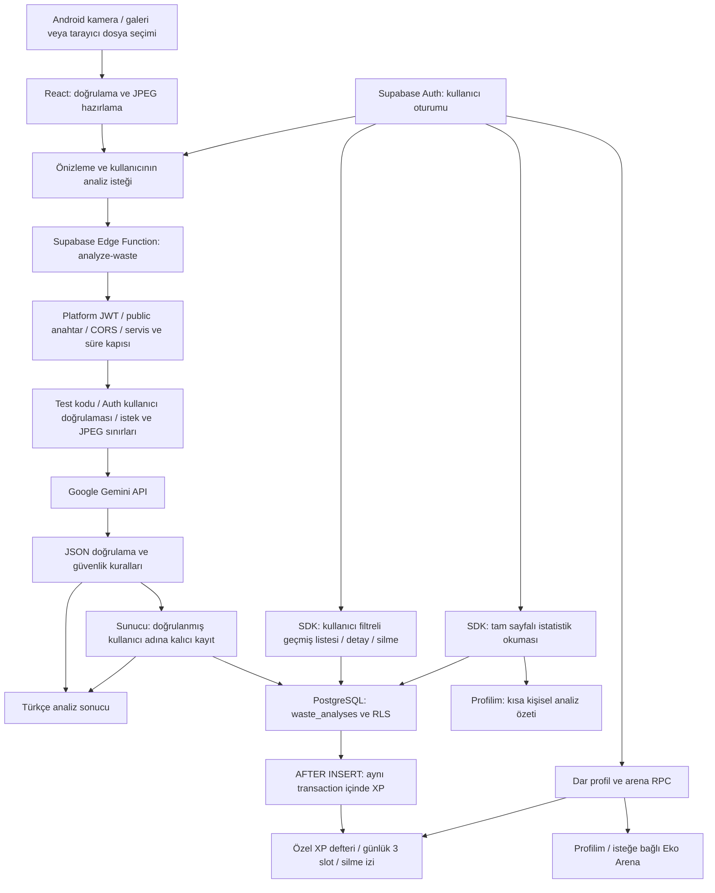

# Akıllı Atık

Akıllı Atık, atık fotoğraflarından Türkçe ayrıştırma önerileri sunan bir üniversite sosyal sorumluluk projesidir. React arayüzü Capacitor ile Android uygulamasına paketlenir; görüntü analizi güvenli Supabase Edge Function üzerinden Google Gemini API ile gerçekleştirilir. Başarılı analizlerin metin sonuçları kullanıcıya özel saklanır.

**Güncel durum — 16 Ekim 2026, Phase 5 / STEP 2C:** Onaylı migration sonrasında yalnız izin verilen tek plastik şişe analizine atomik **200 XP** aktarıldı. Gerçek kullanıcı SDK'sı ve Profilim ekranı **Seviye 2, Geri Dönüşüm Çırağı, %66,67 ilerleme ve kalan 50 XP** ile eşleşiyor. Tek kazanım ve gerekli tek profil var; mevcut analiz/hesap korundu. Önce katılmamış hesabın görünmediği, sonra ayrı kullanıcı onayıyla **EkoGezgin / Arena katılımı açık / sıra #1** doğrulandı. Canlı listede yalnız izin verilen takma ad, XP, seviye ve sıra bilgileri var. RLS/yetkiler, Edge **v12 / verify_jwt=true** ve **ANALYSIS_ENABLED=false** korundu. Onaylanan kapsam **PASS**; ayrılma kontrolü canlı katılım kapatılmadan izole testlerle yapıldı. [Canlı backfill raporu](docs/phase5-step2c-live-backfill.md) güncel sonucu, [migration raporu](docs/phase5-step2c-live-migration.md) önceki şema uygulamasını açıklar.

## Proje Tanıtımı

### Amaç ve Problem

Günlük yaşamda atığın malzemesini ve doğru teslim yöntemini belirlemek her zaman kolay değildir. Yanlış ayrıştırma geri dönüştürülebilir malzemeleri kirletebilir; pil ve elektronik gibi özel toplama gerektiren atıkların evsel çöpe karışmasına neden olabilir.

Projenin amacı, bir fotoğraf üzerinden anlaşılır yönlendirme sağlayarak doğru ayrıştırma alışkanlığını desteklemektir. Görsel değerlendirme kesin teşhis olarak sunulmaz; belirsizlikler ve yerel kuralların doğrulanması gereği açıklanır.

### Sosyal Sorumluluk Katkısı ve Hedef Kullanıcılar

Öğrenciler, haneler ve geri dönüşüm konusunda bilgiye ihtiyaç duyan Android kullanıcıları hedeflenir. Çevre farkındalığını artırmak, özel atıkların güvenli teslimini teşvik etmek ve geri dönüşüm eğitimini erişilebilir kılmak amaçlanır. Henüz ölçülmüş çevresel etki veya tasarruf sonucu bulunmamaktadır.

## Temel Özellikler

### Geliştirilmiş Özellikler

- Türkçe arayüz, mobil navigasyon, uyarlanabilir düzen ve güvenli ekran alanı stilleri.
- Capacitor Camera ile Android kamerasından fotoğraf alma ve galeriden tek görsel seçme.
- Tarayıcıda dosya seçimi; destekleyen mobil tarayıcılarda kamera seçeneği.
- Fotoğraf önizleme, değiştirme ve kaldırma; izin reddi ve iptal yönetimi.
- JPG/PNG/WebP içerik kontrolü, boyut sınırı ve oranı koruyan JPEG hazırlama.
- Analiz/yeniden deneme, yükleniyor göstergesi, sonuç kartı ve Türkçe hata yönetimi.
- Sunucuda Gemini görüntü isteği, JSON doğrulaması ve tehlikeli atık güvenlik kuralları.
- Supabase Authentication ile kayıt, giriş, çıkış ve oturum yönetimi; korumalı kullanıcı ekranları.
- Güvenli parola kurtarma akışı, HTTP 429 ayrımı ve aynı işlemin tekrar gönderilmesini önleyen kontroller.
- Herkese açık karşılama ekranı, kişisel ana panel ve çıkışta kişisel içeriğin temizlenmesi.
- Public proje anahtarı, platform ve uygulama JWT kontrolü, kesin CORS listesi, süreli test erişimi ve bellek içi istek sınırları.
- Başarılı analiz metninin sunucuda kullanıcı sahipliğiyle kaydı; analiz başarısı ile kayıt başarısının ayrı gösterimi.
- Kullanıcıya özel geçmiş listesi, kayıt detayları, yenileme, 12 kayıtlık sayfalama ve onayla silme.
- Profilim: takma ad, XP, seviye/unvan, ilerleme, doğrulanabilir rozetler, kendi sırası ve isteğe bağlı Arena katılımı; gerçek hesapta 200 XP/Seviye 2/İlk Tanıma ve analiz özeti; ayrı onayla EkoGezgin takma adı/katılım kaydı doğrulandı.
- Eko Arena: yalnız gönüllü katılımcılar, ilk üç sıra, 20 kişilik sayfalama, kendi satırı ve yenileme; sahte kullanıcı bulunmaz.
- Mevcut tam kayıt istatistik hesaplamalarıyla kısa kişisel özet ve son üç analiz; grafik ekranı ürün navigasyonunda bulunmaz.
- Hesap kapsamlı yükleme/boş/hata yönetimi, çıkış ve kullanıcı değişiminde kişisel verinin temizlenmesi.
- Mavi/turkuaz arayüz, görünümde bir kez çalışan adım animasyonları ve azaltılmış hareket desteği.
- Android debug APK üretimi ve APK imza doğrulaması.

Kamera/galeri kodu uygulanmıştır; gerçek cihaz doğrulaması beklenmektedir. Gerçek web analizinde HTTP 200, geçerli Türkçe JSON, `saved` sonucu, doğru kullanıcı sahipliği ve kayıt okuması doğrulandı; test sonunda servis kapatıldı. Geçmiş arayüzünün mock tarayıcı testleri bu gerçek analiz testinden ayrıdır.

### Henüz Tamamlanmamış Özellikler

XP/Profilim/Eko Arena migration'ı, onaylı tek kayıt backfill'i ve gerçek hesabın Profilim, katılmamış Arena ve onaylı katılım okumaları doğrulandı. Çok kullanıcılı sıralama ve mevcut katılımı kapatan canlı ayrılma testi yapılmadı. Analiz yanıtında işlem başına XP/kazanılmama nedeni henüz bulunmaz. Harita veya doğrulanmamış çevresel katkı hesabı bulunmaz. Gerçek Android cihaz akışı doğrulanmamıştır. Sahte analiz, puan veya kullanıcı üretilmez.

## Kullanılan Teknolojiler

| Katman | Teknoloji | Kullanım |
| --- | --- | --- |
| Arayüz | React 19, TypeScript 5.9 | Bileşenler, tip kontrolü ve durum yönetimi |
| Geliştirme ve derleme | Vite 8 | Yerel geliştirme ve üretim paketi |
| Stil | Tailwind CSS 4, özel CSS | Uyarlanabilir düzen ve erişilebilirlik stilleri |
| Navigasyon | React Router 7 | Sayfalar ve ortak düzen |
| Mobil köprü | Capacitor 8, Camera ve App | Android paketleme, fotoğraf ve geri yükleme |
| Android | JDK 21, SDK 36, Gradle 8.14.3, AGP 8.13.0 | Native proje ve debug APK |
| Servis platformu | Supabase Auth, PostgreSQL, JavaScript istemcisi | Kullanıcı oturumu, RLS ve kullanıcıya özel analiz geçmişi |
| Sunucu | Supabase Edge Functions, Deno | HTTP uç noktası ve secret yönetimi |
| Yapay zekâ | Google Gemini API, gemini-3.5-flash-lite | Görüntü ve JSON şemalı analiz; kontrollü gerçek web çağrısı doğrulandı |
| Kalite | TypeScript, ESLint, Node.js test araçları, izole PostgreSQL | Uygulama/Edge unit testleri, RLS izolasyonu ve tarayıcı regresyonları |

Tekrarlanabilir kurulum için `package-lock.json`, Android araç sürümleri için Gradle wrapper esas alınır.

## Sistem Mimarisi



Şemanın analiz kolu yalnız ayrı onayla açılan kontrollü test penceresinde çalışır. Mevcut canlı serviste uygun erişim isteği **503 / `SERVICE_DISABLED`** ile sonlanır; Gemini'ye aktarılmaz. Geçmiş okuma, analiz servisi kapalıyken de kullanıcının SDK oturumu ve RLS üzerinden çalışabilir.

Fotoğraf seçimi tek başına analiz başlatmaz. Analiz düğmesi küçültülmüş JPEG'i, mevcut SDK kullanıcı JWT'sini ve kullanıcı/istek tekrarını tanımlayan UUID'yi Edge Function'a iletir. Frontend Gemini veya service role anahtarını bilmez; kayıt sahibini sunucuda doğrulanan JWT belirler. Sunucu modeli çağırır, sonucu doğrular ve yalnız başarılı analizi kaydeder. İstemci yanıtı tekrar doğrular; kayıt hatası geçerli analiz sonucunu silmez. Fotoğraf veya kullanıcı değiştiğinde eski kişisel sonuç gösterilmez.

Geçmiş servisi yalnız sabit 15 kolonu okur, kayıtları doğrular ve sahibi farklı olan yanıtı reddeder. Liste sırası `created_at DESC, id DESC` şeklindedir; 12+1 keyset sayfalama veritabanı zamanının mikro-saniyelerini korur. Detay ve silme istekleri kayıt ID'si ile kullanıcı ID'sine birlikte filtrelenir; RLS ayrıca uygulanır. Silme kullanıcı onayından sonra yapılır; sonuç beklenirken oturum değişimi eski veriyi ekrana taşımaz.

İstatistik servisi yalnız `id, user_id, created_at, category` alanlarını 500 kayıtlık keyset sayfalarıyla eksiksiz okur. İlk/kalan/son exact count ve tekrar ID kontrolleri tamamlanmadan sonuç gösterilmez. Profilim bu servisin toplam/farklı kategori/en sık kategori özetini yeniden kullanır. Önceki günlük/haftalık hesaplamalar ve testleri korunur; bağımsız grafik ekranı render edilmez. Çoklu HTTP okuması atomik veritabanı snapshot'ı değildir.

XP tetikleyicisi başarılı analiz INSERT'ine aynı transaction içinde kazanım ekler. Belirsiz, çok nesneli ve Diğer analizleri puansızdır; günlük üç slot İstanbul saatine göre sayılır. Analiz silme aktif XP'yi kaldırır fakat günlük slot ve tekrar izini geri açmaz. Profil/arena RPC'leri kullanıcıyı sunucuda belirler; istemciden XP veya kullanıcı kimliği almaz. Toplam ve sıralama aktif defterden türetilir. SQL/RPC katmanı canlıya uygulanmış; ayrı onayla mevcut tek kayda 200 XP aktarılmış ve gerçek Profilim/Arena akışı doğrulanmıştır. Analiz servisi **ANALYSIS_ENABLED=false** olarak kapalıdır.

## Profilim, XP ve Eko Arena

Profilim; takma adı, toplam aktif XP'yi, seviyeyi ve unvanı, sonraki seviyeye kalan XP'yi, ilerleme çubuğunu ve rozetleri gösterir. Mevcut istatistik servisi kısa analiz özeti için kullanılır; bağımsız İstatistikler menüsü kaldırılmış, eski adres Profilim'e yönlendirilmiştir.

Sunucu, şema sürümü 1 olan, belirsiz olmayan tek nesneli ve başarıyla kaydedilmiş analizleri aşağıdaki kuralla puanlar:

| Kategori | XP |
| --- | ---: |
| Organik | 50 |
| Kâğıt/Karton | 75 |
| Cam | 100 |
| Metal | 150 |
| Plastik | 200 |
| Pil | 250 |
| Elektronik | 300 |
| Diğer | 0 |

XP, doğrulanmış atık tanıma ve çevresel farkındalık etkinliğini temsil eder. Fotoğraf analizi, fiziksel geri dönüşüm yapıldığının kanıtı değildir. Her kullanıcı için `Europe/Istanbul` gününde en fazla üç analiz puanlanır. Benzersiz kaynak/request ve günlük slot kısıtları tekrar puanlamayı önler; puan değeri istemciden alınmaz.

| Seviye | En az toplam XP | Unvan |
| --- | ---: | --- |
| 1 | 0 | Doğa Meraklısı |
| 2 | 100 | Geri Dönüşüm Çırağı |
| 3 | 250 | Çevre Dostu |
| 4 | 500 | Eko Kaşif |
| 5 | 1.000 | Yeşil Öncü |
| 6 | 1.750 | Doğa Koruyucusu |
| 7 | 2.750 | Sürdürülebilirlik Elçisi |
| 8 | 4.000 | Çevre Şampiyonu |

Eko Arena'ya katılım varsayılan olarak kapalıdır; kullanıcı benzersiz takma adını ve katılım tercihini açıkça kaydeder. Sıralama toplam aktif XP'ye, eşitlikte normalize edilmiş takma ada göre hesaplanır. İlk üç katılımcı öne çıkarılır; liste 20 kişilik sayfalarla okunur. Diğer giriş yapmış kullanıcılara yalnız sıra, takma ad, XP, seviye/unvan ve kendi satırı işareti gösterilir. E-posta, Auth kimliği veya token yayınlanmaz.

STEP 2C gerçek servis doğrulamasında **EkoGezgin, 200 XP, Seviye 2, %66,67 ilerleme, kalan 50 XP ve tek katılımcı içinde #1** eşleşti. Katılım açılmadan önce hesap sıralamada görünmüyordu. Ayrılma işlevi mevcut canlı katılım korunarak izole SQL ve mock arayüz testinde doğrulandı. Ayrıntılar [canlı sonuç raporundadır](docs/phase5-step2c-live-backfill.md).

## Proje Yapısı

```text
Akilli-Atik/
├── src/
│   ├── components/           # Ortak düzen, boş durum ve analiz sonucu
│   ├── auth/                 # Oturum sağlayıcısı ve korumalı rotalar
│   ├── data/                 # Atık kategorileri
│   ├── hooks/                # Fotoğraf, analiz, geçmiş, özet ve oyunlaştırma durumu
│   ├── pages/                # Karşılama, panel, tarama, Auth, geçmiş, Profilim ve Arena
│   ├── services/             # Auth, fotoğraf, analiz, geçmiş, istatistik ve profil RPC
│   ├── App.tsx               # Uygulama rotaları
│   ├── main.tsx              # React başlangıcı
│   └── styles.css            # Mobil/masaüstü stilleri
├── supabase/
│   ├── config.toml           # Function giriş noktası ve JWT ayarı
│   ├── migrations/           # Sürüm kontrollü tablo, kısıt ve RLS tasarımı
│   ├── tests/                # İzole PostgreSQL/RLS senaryoları
│   └── functions/
│       ├── _shared/          # Ortak JSON, hata ve JPEG kuralları
│       ├── analyze-waste/    # HTTP, JWT, Gemini, kayıt ve kesin süre kapısı
│       ├── runtime.d.ts      # Tip kontrolü için Deno tanımları
│       └── .env.example      # Sunucu ayar şablonu
├── tests/                    # Auth, kurtarma, analiz, geçmiş ve güvenlik testleri
├── scripts/                  # İzole veritabanı test çalıştırıcısı
├── android/                  # Native Android kaynakları ve Gradle wrapper
├── docs/                     # Doğrulama raporu ve tarihsel kayıtlar
├── .env.example              # Public frontend ayar şablonu
├── capacitor.config.ts       # Uygulama kimliği, adı ve web çıktısı
├── package.json              # Komutlar ve bağımlılıklar
└── tsconfig*.json            # Frontend, araç ve Edge tip kontrolleri
```

`node_modules`, `dist`, yerel `.env` dosyaları, SDK yolu, cache, üretilmiş Android web varlıkları ve APK Git'e dahil edilmez. `android:sync` gerekli varlıkları yeniden üretir.

## Kurulum ve Çalıştırma

### Gereksinimler

- Git, Node.js **24 LTS** ve npm. Kontroller Node.js 24.18.0 / npm 11.16.0 ile yapılmıştır; testler Node'un TypeScript tiplerini kaldırma desteğini kullanır.
- Android için JDK 21, Android Studio, SDK Platform 36, Build-Tools 36.0.0 ve Platform-Tools. SDK lisansları kabul edilmiş olmalıdır.
- Canlı sunucu yönetimi için Supabase hesabı ve CLI; doğrulanan CLI sürümü 2.120.0.

### npm Kurulumu ve Yerel Geliştirme

Repository'yi klonladıktan sonra proje dizininde:

```powershell
npm ci
npm run dev
```

Terminalde verilen adresi açın; varsayılan `http://localhost:5173` olur. Fotoğraf seçimi ve arayüz için Gemini anahtarı gerekmez.

Karşılama ekranı herkese açıktır. Kişisel panel, tarama ve analiz geçmişi için uygulama hesabıyla giriş gerekir; Supabase Dashboard hesabı uygulama hesabının yerine geçmez. Kayıt/doğrulama ve parola kurtarma akışları mevcut Auth ayarlarını kullanır. Gerçek e-posta gönderimi, yeni test hesabı veya canlı ayar değişikliği için ayrıca kullanıcı onayı alınır.

```powershell
npm run build
npm run preview
```

`preview` üretim sunucusu değildir. Web yayını yapılırsa React Router rotaları için `index.html` yönlendirmesi gerekir.

### Frontend Ortam Değişkenleri

`.env.example` dosyasını `.env.local` olarak kopyalayın; mevcut yerel dosyanız varsa üzerine yazmayın. Yalnız URL ve **public publishable/anon** anahtarını ekleyin:

```dotenv
VITE_SUPABASE_URL=https://PROJECT_REF.supabase.co
VITE_SUPABASE_PUBLISHABLE_KEY=
```

`VITE_` değerleri frontend paketine dahil edilir. Gemini, service_role veya `sb_secret_` anahtarları buraya eklenmez. Ayar değişince geliştirme sunucusunu yeniden başlatın; APK'yı yeniden derleyin.

### Android Senkronizasyonu ve APK

`JAVA_HOME` JDK 21 dizinini, `ANDROID_HOME` SDK dizinini göstermelidir. SDK yolu Android Studio veya Git dışında kalan `android/local.properties` üzerinden de ayarlanır. Ortam değişkenlerini güncelledikten sonra terminali yeniden açın.

```powershell
npm run android:sync
npm run android:open
npm run android:apk
```

`android:sync` üretim paketini oluşturup Android'e kopyalar; `android:open` Android Studio'yu açar. `android:apk` build, sync ve `assembleDebug` adımlarını içerir. Çıktı:

```text
android/app/build/outputs/apk/debug/app-debug.apk
```

Uygulama adı **Akıllı Atık**, kimliği **`com.akilliatik.app`**, minimum API **24**, hedef/derleme API **36**'dır. USB hata ayıklaması etkin ve bilgisayara yetki verilmiş telefona kurulum:

```powershell
adb devices
adb install -r android/app/build/outputs/apk/debug/app-debug.apk
```

Debug APK geliştirme içindir; mağaza yayını ve release imzalama bu kapsamda yapılmamıştır.

### Supabase Yapılandırması

Bağımsız proje **Akilli-Atik**, Project Ref **`nyoxbwandadakfagoner`**, URL **`https://nyoxbwandadakfagoner.supabase.co`**'dur. Bunlar public tanımlayıcılardır; gerçek anahtar değerleri repository'de bulunmaz. Yetkili bakımda önce doğru hesap ve proje doğrulanır:

```powershell
npx supabase@2.120.0 login
npx supabase@2.120.0 projects list
npx supabase@2.120.0 link --project-ref nyoxbwandadakfagoner
```

Doğrulama kodlarını yalnız standart giriş ekranlarında kullanın; Git'e, rapora veya sohbete eklemeyin. Başka Supabase projeleri bu uygulama için kullanılmaz. Dashboard → Edge Functions → Secrets ayarları:

| Ayar | Amaç ve güncel durum |
| --- | --- |
| `GEMINI_API_KEY` | Yalnız sunucuda; STEP 4.3'te onaylı gerçek analiz başarılı |
| `GEMINI_MODEL` | `gemini-3.5-flash-lite` |
| `ANALYSIS_ENABLED` | **false**; ayrı onay olmadan değiştirilmez |
| `ANALYSIS_PUBLIC_KEY` | Frontend ile eşleşen public anahtar; değeri belgelenmez |
| `ALLOWED_ORIGINS` | `https://localhost,http://localhost,capacitor://localhost,http://localhost:5173` |
| `ANALYSIS_TEST_TOKEN` | Yalnız onaylı kısa test için üretilir; değeri repoya veya loglara yazılmaz |
| `ANALYSIS_TEST_EXPIRES_AT` | UTC son tarih; dış sunucu kapısı en fazla 10 dakikalık pencere kabul eder |
| `SUPABASE_URL`, `SUPABASE_SERVICE_ROLE_KEY` | Güvenilir Edge runtime yapılandırması; service role istemciye aktarılmaz |

Canlı `waste_analyses` migration'ı uygulanmıştır; mevcut veritabanına kurulum sırasında tekrar migration uygulamayın. Yeni bir ortam için önce şema ve migration geçmişi incelenir, SQL/RLS testleri çalıştırılır ve yalnız gerekli migration ayrı onayla uygulanır. İstemci bu tabloya doğrudan INSERT/UPDATE yapamaz; başarılı kaydı yalnız güvenilir Edge Function oluşturur.

Bu kurulum komutları analiz etkinleştirme veya deployment talimatı değildir. Mevcut servis kapalı tutulur. Yeni gerçek test; fotoğrafın Google'a gönderimi, sonucun kalıcı saklanması ve en fazla 10 dakikalık etkinleştirme için ayrı açık izin gerektirir. Test/hata sonunda bağımsız kapatma aracı ve HTTP 503 ile kapanış doğrulanır. [Kapalı deployment](docs/phase4-step43-closed-deployment.md) ve [gerçek analiz sonucu](docs/phase4-step43-live-analysis-result.md) bu işlemlerin sınırlarını açıklar.

## Yapay Zekâ Analiz Sistemi

### Fotoğraf Yükleme ve Görüntü Doğrulama

İstemci en fazla **20 MiB** JPG/PNG/WebP girdisini kabul eder; dosya uzantısına ek olarak içerik imzasını kontrol eder. **64 milyon piksel** üzeri görseller reddedilir. En-boy oranı korunarak en uzun kenar **1600 piksel** yapılır; JPEG çıktı **5 MiB** sınırına tabidir.

Sunucu `image/jpeg` türünü, akış boyutunu ve JPEG yapı/ölçülerini tekrar kontrol eder. `Content-Length` bulunmasa da boyut sınırı uygulanır. Bu kontrol tam görüntü çözücüsü değildir; çözülebilirlik Gemini tarafında da değerlendirilir.

### Gemini Analizi ve JSON Yanıtı

Gemini REST `generateContent` isteği görüntü ve Türkçe sistem talimatı içerir; JSON şemalı çıktı ister. Yalnız tamamlanmış yanıt alınır. Şema dışı alanlar, geçersiz kategori, eksik alan, yanlış tür ve tutarsız başarı bilgisi reddedilir.

| Alan | Açıklama |
| --- | --- |
| `success` | Atık analizi başarılı mı? |
| `wasteName`, `category` | Ad ve kategori; atık yoksa null |
| `description` | Kısa Türkçe açıklama |
| `sortingInstruction` | Ayrıştırma talimatı |
| `recyclingAdvice` | Geri dönüşüm/teslim önerisi |
| `safetyWarning` | Güvenlik uyarısı veya null |
| `objectCount` | none, single veya multiple |
| `uncertain`, `hazardous` | Belirsizlik ve özel güvenlik işaretleri |

Kategoriler: **Plastik, Cam, Kâğıt/Karton, Metal, Organik, Elektronik, Pil, Diğer**. Birden fazla atıkta baskın nesnenin değerlendirildiği belirtilir; güvenli seçim yapılamıyorsa başarısız sonuç döner. Atık bulunamaması başarılı sınıflandırma sayılmaz. Güven yüzdesi üretilmez veya gösterilmez.

### Güvenlik Kontrolleri ve Hatalar

Pil, elektronik, tehlikeli işareti veya riskli nesne adı için ayrıştırma metni koruyucu kurallarla değiştirilir. Sökme, delme, yakma, hasarlı cihazı şarj etme ve evsel çöpe atma yönlendirmelerinin riski azaltılır. Modelin tehlikeli nesneyi kaçırmayacağı garanti edilmez; yerel kurallar yetkili kuruluşla doğrulanmalıdır.

İnternet yokluğu, ayar eksikliği, kapalı servis, erişim reddi, kota aşımı, geçersiz fotoğraf/JSON, servis hatası ve zaman aşımı Türkçe mesajlarla ele alınır. Fotoğraf değişimi veya ekranın kapanması aktif istemci isteğini iptal eder.

## Güvenlik

- Gemini anahtarı yalnız Supabase Edge secret'ıdır; frontend veya Git'e eklenmez.
- Yerel ortam dosyaları, CLI oturumu/doğrulama dosyaları, keystore, APK, cache ve rapor çıktıları Git dışında tutulur. Boş `.env.example` şablonları paylaşılır.
- `verify_jwt=true` platform denetimi korunur. Handler kullanıcı JWT'sini ayrıca bu projenin `/auth/v1/user` uç noktasıyla doğrular; public anahtar tek başına kullanıcı kimliği değildir. Kapalı servisin erken 503 yanıtı tek başına uygulama JWT doğrulaması kanıtı sayılmaz.
- Analiz açıldığında 32–256 karakterlik test kodu ve UTC bitiş zamanı zorunludur. Dış sunucu kapısı **en fazla 10 dakika** kabul eder; iç test kodu denetimindeki 15 dakikalık üst sınır bu dış kapıyı uzatmaz. Eksik, geçersiz veya süresi dolmuş zaman penceresi 503; geçersiz test kodu 403 ile reddedilir.
- Mutlak sunucu süresi erişimi kapatır ve Gemini HTTP isteğini iptal eder; remote `ANALYSIS_ENABLED` secret'ını değiştirmez. Ana süreç/bağımsız watchdog false yazımını ve 503 yanıtını ayrıca doğrular. Önceden gönderilmiş bir veritabanı işlemi geri alınmış sayılmaz.
- Test kodu yalnız ekran belleğinde tutulur; `VITE_`, kalıcı depolama veya log'a eklenmez. Native HMAC doğrulaması kullanılır.
- CORS tam origin listesi kullanır; joker izin yoktur. CORS kimlik doğrulama değildir; originsiz istek de erişim kontrolünden geçer.
- Isolate başına 3 istek/IP/dakika, 30 istek/saat ve 2 eşzamanlı çağrı sınırı vardır. IP header'ı yardımcı sinyaldir; bellek içi sınırlar dağıtık kalıcı kota sağlamaz.
- Gövde okuma 10 saniye, Gemini çağrısı 35 saniye, normal analiz istemcisi 75 saniye zaman aşımına tabidir. Provider yanıtı en fazla 64.000 bayt okunur; kesin test süresi bu bütçelerden önce dolabilir.
- Uygulama fotoğrafı, base64 verisini, tokenları veya ham Gemini yanıtını veritabanına kaydetmez. Başarılı ve doğrulanmış analiz metni, kategori, model ve güvenlik alanları `waste_analyses` tablosunda kullanıcıya ait saklanır. Etkin analizde görüntü Supabase ve Google üzerinden işlenir; sağlayıcı veri politikaları ayrıca geçerlidir.
- RLS kullanıcıya yalnız kendi kayıtları için SELECT/DELETE izni verir. Anonim erişim ve istemci INSERT/UPDATE kapalıdır. Sunucunun service role yetkisi tablo üzerinde SELECT/INSERT ile sınırlandırılmıştır; sahiplik doğrulanmış JWT'den alınır.
- `(user_id, client_request_id)` benzersizliği çift kaydı engeller; farklı sunucu isolate'larında eşzamanlı iki Gemini çağrısını tek başına engellemez. Frontend ve Gemini adaptörü otomatik analiz tekrarı yapmaz.
- Geçmiş istekleri oturumu ve beklenen kullanıcıyı öncesinde/sonrasında kontrol eder. Çıkış veya hesap değişiminde istek iptali ve geç gelen yanıtın reddi uygulanır; JWT'nin sunucudaki geçerlilik süresi ayrıca Supabase tarafından yönetilir.
- XP şeması kaynak analiz INSERT'iyle atomiktir; profil satırı kilidi ve benzersiz günlük slotlar üç sınırını korur. Silme sonrası özel defterde kalan kota/request izi yeniden puanlamayı önler; hesap silinince CASCADE uygulanır. İstemci veya service role doğrudan XP defterini yazamaz. Canlı kısıt/yetki doğrulaması, önceki izole eşzamanlılık testlerinden ayrı raporlanır.
- Arena'ya katılım varsayılan kapalıdır. Paylaşılan DTO yalnız sıra, takma ad, XP, seviye/unvan ve kendi satırı işaretini içerir. Takma ad tercihi kaydedilmeden katılım açılmaz; XP fiziksel geri dönüşüm kanıtı değildir.

Koruma kontrollü pilot içindir. Genel kullanım öncesi dağıtık kota, maliyet sınırları, yetkilendirme kapsamı ve operasyonel izleme ayrıca değerlendirilmelidir.

## Testler

```powershell
npm run typecheck
npm run lint
npm test
npm run test:db
npm run build
npm run android:apk
```

Unit ve mock tarayıcı testleri gerçek Supabase/Gemini çağrısı yapmaz. Sentetik yanıtlar test araçlarında bulunur; uygulama sahte sonuç üretmez. Kapsam: Auth/oturum izolasyonu, parola kurtarma ve 429 yönetimi, fotoğraf/JSON doğrulaması, tehlikeli atık kuralları, JWT/CORS/süre kapısı, güvenilir kayıt, geçmiş listeleme/detay/silme ve geç gelen yanıtların reddi.

`test:db`, Docker üzerinde ağsız ve geçici PostgreSQL konteyneri kullanır; kurulu Docker ve yerel imaj/araç erişimi gerekir. Önce mevcut 104 kontrol, ardından yeni XP/RLS ve bağımsız bağlantılı eşzamanlılık testleri çalışır. Sentetik kullanıcı/fixture verileri canlı projeye uygulanmaz. SQL/RLS sonuçları gerçek iki kullanıcının canlı hesabıyla yapılmış test olarak sunulmaz. `scripts/backfill-xp.sql` varsayılan salt okunur dry-run'dır; yalnız izole yerel test veritabanına izin verir, canlı kullanım için ayrı değerlendirme gerekir.

| Kontrol | Sonuç ve kapsam — 16 Ekim 2026 |
| --- | --- |
| TypeScript: React, araçlar ve Edge | GitHub senkronizasyonu öncesinde yeniden PASS, exit 0 |
| ESLint | GitHub senkronizasyonu öncesinde yeniden PASS, exit 0 |
| Uygulama/Edge unit testleri | Güncel koşumda **303/303 PASS**, başarısız 0 |
| İzole PostgreSQL/RLS | Güncel koşumda **212/212 PASS**; ayrıca **17/17** bağımsız bağlantılı yarış/araç kontrolü, toplam **229** |
| GitHub senkronizasyonu güncel tarayıcı/UX kontrolü | **Kullanıcı tarafından manuel PASS bildirildi**; yerel QA sayfası tarayıcıda çalıştırıldı. Collector raporu oluşmadığı için bağımsız otomatik kontrol sayısı doğrulanmadı; önceki 377 sonuç yeni koşum sayılmaz |
| Geçmiş arayüzü mock tarayıcı kontrolleri | **48/48 başarılı**; iptal, Escape ve odak dönüşü dahil; gerçek servis testi değildir |
| İstatistik arayüzü mock tarayıcı kontrolleri | **44/44 başarılı**, 12 senaryo; canlı salt okunur kontrol ayrıca yapıldı |
| Yeni Profilim / Eko Arena mock tarayıcı | **72/72 başarılı**, 24 senaryo; gerçek Supabase yazma veya canlı XP kabulü değildir |
| STEP 2B toplam mock tarayıcı kontrolü | **377/377 başarılı**; Auth 21, kurtarma 40, 429/istek 29, UX 48, analiz 18, geçmiş 48, istatistik 44, animasyon 57, profil/Arena 72; STEP 2C'de yeniden koşulmadı |
| Production build | GitHub senkronizasyonu öncesinde yeniden PASS; 612,14 kB chunk boyutu uyarısı sürüyor |
| Capacitor sync, Android Gradle | Güncel `cap sync android` ve çevrimdışı `assembleDebug` PASS; kaynak/Capacitor yapılandırması değişmedi |
| APK imzası | Son metin düzeltmesinden sonra APK yeniden paketlendi; v2 imza ve dört üretim dosyası eşleşmesi PASS; 9.896.425 bayt |
| STEP 2C onaylı canlı migration | **PASS**; iki yeni tablo, 13 işlev, RLS/ACL/kısıt/index ve mevcut kayıt/hesap korunması doğrulandı |
| STEP 2C tek kayıt backfill ve gerçek Profilim/Arena | **PASS**; tek 200 XP, Seviye 2, kalan 50 XP, doğru sahiplik; önce opt-out/boş liste, ayrı onayla EkoGezgin katılımı ve sıra #1 |
| STEP 2C ayrılma kontrolü | Güncel yerel SQL ve bir hedefli mock tarayıcı senaryosu PASS; canlı EkoGezgin katılımı açık kaldı |
| Gerçek Gemini + sunucudan kayıt + SDK okuma | STEP 4.3: **HTTP 200, saved, doğru kullanıcı ve tek kayıt** |
| Canlı güvenlik/kapatma | Eksik JWT 401, yanlış public anahtar 403, anonim veri okuma 401/42501; sonunda 503 |
| STEP 5 canlı geçmiş arayüzü okuması | **PASS**, gerçek SDK ile kullanıcıya ait tek kayıt liste/detay ekranlarında okundu; silme onayı Vazgeç ile kapatıldı, gerçek DELETE yapılmadı |
| Phase 5 / STEP 1 canlı istatistik okuması | **PASS**, 1 analiz / 1 kategori / %100 Plastik; 16 Ekim günü ve 12–18 Ekim haftası 1; yalnız SELECT/HEAD |
| Gerçek e-posta akışlarının tümü | **Tamamı canlı doğrulandı kabul edilmez**; ilgili Auth/kurtarma raporlarına bakın |
| Android cihaz/emülatör işlev testi | **Yapılmadı** |

STEP 2C backfill sonrasında TypeScript, ESLint, unit, SQL/RLS ve production build yeniden çalıştırıldı. Tek kayda özel aktarım SQL'i işlem öncesinde ayrıca **8/8 izole kontrolü** geçti; bu sayı ana DB test toplamına eklenmez. Gerçek Profilim/Arena ve anonim 401 kontrolleri, önceki mock tarayıcı testlerinden ayrıdır. STEP 2C sırasında bir hedefli mock ayrılma senaryosu çalıştı; bütün 377 mock regresyon ve APK/cihaz testleri o adımda yeniden koşulmadı. Kanıt kapsamı [canlı backfill raporundadır](docs/phase5-step2c-live-backfill.md). Sonraki GitHub senkronizasyonunda yeniden çalıştırılan kontroller ve kapsam sınırları [güncel doğrulama raporunda](docs/github-sync-verification.md) ayrıca belirtilir.

[STEP 2B teknik raporu](docs/phase5-step2b-gamification.md) güncel yerel kabul durumunu; [STEP 1 raporu](docs/phase5-step1-statistics.md), [geçmiş raporu](docs/phase4-step5-analysis-history.md) ve [STEP 4.3 canlı analiz raporu](docs/phase4-step43-live-analysis-result.md) önceki gerçek servis kanıtlarını açıklar. [İlk doğrulama raporundaki](docs/dogrulama-raporu.md) 34 test tarihsel sonuçtur. Unit/mock testleri canlı Supabase veya fiziksel Android testi yerine geçmez.

## Geliştirme Aşamaları

| Aşama | Kapsam | Durum |
| --- | --- | --- |
| Phase 1 | React/TypeScript/Vite, sayfalar ve navigasyon | Tamamlandı |
| Phase 1.1 | Capacitor ve Android proje altyapısı | Tamamlandı; eksik araçlar Phase 1.2'de giderildi |
| Phase 1.2 | JDK/SDK/Android Studio, debug APK ve imza | Tamamlandı; cihaz testi hariç |
| Phase 2 | Kamera/galeri, önizleme ve fotoğraf hazırlama | Kod/otomatik kontroller tamamlandı; cihaz testi bekliyor |
| Phase 3 | Gemini/Edge kodu, JSON, güvenlik ve analiz ekranı | Kod/otomatik kontroller hazır; gerçek API akışı sonraki adımlarda doğrulandı |
| Phase 3.1 | Supabase bağlantısı ve kontrollü gerçek analiz | Web analizi doğrulandı; bütün aşama için Android cihaz maddesi açık |
| Phase 4 / STEP 2–4.2 | PostgreSQL/RLS, Auth, güvenilir analiz kaydı ve kapalı deployment | Canlı migration ve kapalı deployment doğrulandı; Auth canlı kapsamı ilgili raporda sınırlı |
| Phase 4 / STEP 4.3 | Gerçek Gemini analizi ve kullanıcıya ait kalıcı kayıt | Onaylanan web kapsamı PASS; cihaz/ikinci kullanıcı/duplicate canlı senaryoları açık |
| Phase 4 / STEP 5 | Kullanıcıya özel geçmiş listesi, detay ve silme | Yerel testler, nihai APK ve canlı salt okunur web kabulü PASS; gerçek silme/cihaz testi yapılmadı |
| Phase 5 / STEP 1 | Gerçek kullanıcı kayıtlarından istatistik ve grafikler | Canlı salt okunur web kabulü PASS; cihaz testi yapılmadı |
| Phase 5 / STEP 2B | Atomik XP, seviye, rozet, Profilim ve gönüllü Eko Arena | **Yerel PASS**; bu aşamada canlı işlem yoktu, sonraki migration sonucu STEP 2C'de |
| Phase 5 / STEP 2C | Canlı migration, tek kayıt XP aktarımı, profil/Arena ve onaylı katılım | **Onaylanan kapsam PASS**; ayrılma izole testte doğrulandı, mevcut canlı katılım korundu |

Önceki raporlar [geliştirme geçmişinde](docs/gelistirme-gecmisi.md) korunur. Güncel durumu bu README ve son doğrulama raporu belirtir.

## Mevcut Durum ve Sınırlamalar

- Function **ACTIVE, sürüm 12, verify_jwt=true**; analiz **kapalı**. `ACTIVE` durumunun analizin açık olduğu anlamına gelmediğine dikkat edilmelidir.
- `gemini-3.5-flash-lite` ile tek onaylı gerçek web analizi ve kalıcı kayıt doğrulandı. Bu, genel doğruluk, tüm kategoriler veya kota dayanıklılığı kanıtı değildir.
- Test erişimi süreli ve ayrı onaya bağlıdır; önceki test kodu veya fotoğraf izni yeni test yetkisi sayılmaz.
- Android kamera/galeri, izin reddi ve activity geri yükleme cihazda doğrulanmadı.
- Geçmiş listesi/detayı/silme mevcut SDK/RLS üzerinden uygulanmıştır. Gerçek kayıt üzerinde silme veya ikinci kullanıcıya ait veriye erişme testi yapılmaz; silme/izolasyonun otomatik kanıtları canlı testten ayrıdır.
- Kısa analiz özeti analiz adedini ölçer. XP sistemi farkındalık etkinliğidir; çevresel etki veya fiziksel geri dönüşüm hesabı değildir. Tek analiz için onaylı 200 XP aktarımı ve gerçek profil/Arena okuması doğrulandı; sonraki ayrı onayla EkoGezgin katılımı açıldı. Analiz yanıtına XP/neden eklenmesi ayrı geliştirme gerektirir.
- Özet ve sıralama açılış/yenileme/sekme dönüşünde okunur; kaydedilmemiş profil formu sekme dönüşünde kaybolmaz. Sürekli Realtime aboneliği yoktur. Büyük veri setlerinde toplama ve sıralama maliyeti ayrıca ölçülmelidir.
- Release APK/AAB, mağaza yayını, iOS ve genel kullanıcıya açık analiz yoktur.
- STEP 2C migration, tek kayıt aktarımı ve ayrı EkoGezgin katılım onayları uygulandı. Yeni profil tercihi değişikliği veya başka kayda puan için ayrıca izin gerekir; mevcut katılım açık kaldı.

## Sonraki Geliştirme Adımları

1. Canlı backfill ve onaylı EkoGezgin katılım raporunu değerlendirmek. Mevcut kaynakta tek 200 XP kazanımı ve Arena'da sıra #1 var; aynı kayıt tekrar puanlanmaz, katılım izinsiz değiştirilmez.
2. Ayrı kullanıcı izniyle fiziksel Android cihaz akışını ve gerekiyorsa silinmesine açıkça izin verilen bir kayıtta canlı silmeyi doğrulamak. Mevcut korunan gerçek kayıt silinmez.
3. Yeni gerçek analiz istenirse fotoğraf/gönderim/kalıcı kayıt ve süreli etkinleştirme için yeniden açık onay almak.
4. Genel kullanımdan önce dağıtık kota, maliyet ve operasyonel izleme gereksinimlerini değerlendirmek.
5. Sonraki adıma yalnız ayrı kullanıcı onayıyla geçmek.

## Dokümantasyon ve Resmî Kaynaklar

- [GitHub senkronizasyonu ve güncel doğrulama kapsamı](docs/github-sync-verification.md)
- [Doğrulama raporu](docs/dogrulama-raporu.md)
- [Tarihsel geliştirme raporları](docs/gelistirme-gecmisi.md)
- [Veritabanı modeli ve RLS](docs/phase4-step2-database.md) · [Authentication](docs/phase4-step3-authentication.md)
- [Parola kurtarma](docs/password-recovery.md) · [E-posta sınırları ve 429 yönetimi](docs/password-recovery-rate-limit.md)
- [Güvenilir sunucu kaydı](docs/phase4-step4-analysis-storage.md) · [Canlı migration/deployment](docs/phase4-step42-live-deployment.md)
- [Gerçek Gemini analizi ve kalıcı kayıt sonucu](docs/phase4-step43-live-analysis-result.md)
- [STEP 5 analiz geçmişi](docs/phase4-step5-analysis-history.md)
- [Phase 5 / STEP 1 istatistik paneli](docs/phase5-step1-statistics.md)
- [Phase 5 / STEP 2A mimari planı](docs/phase5-step2a-gamification-plan.md) · [STEP 2B yerel geliştirme raporu](docs/phase5-step2b-gamification.md)
- [STEP 2C hazırlık](docs/phase5-step2c-live-preparation.md) · [Canlı migration](docs/phase5-step2c-live-migration.md) · [Kontrollü backfill ve gerçek profil/Arena sonucu](docs/phase5-step2c-live-backfill.md) — onaylı EkoGezgin katılımı doğrulandı; XP/neden sözleşmesi ayrı geliştirme gerektiriyor.
- [Capacitor Android](https://capacitorjs.com/docs/android) · [Camera](https://capacitorjs.com/docs/apis/camera)
- [Supabase Edge Functions](https://supabase.com/docs/guides/functions) · [Secret yönetimi](https://supabase.com/docs/guides/functions/secrets)
- [Gemini modeli](https://ai.google.dev/gemini-api/docs/models/gemini-3.5-flash-lite) · [JSON şemalı çıktı](https://ai.google.dev/gemini-api/docs/structured-output)
