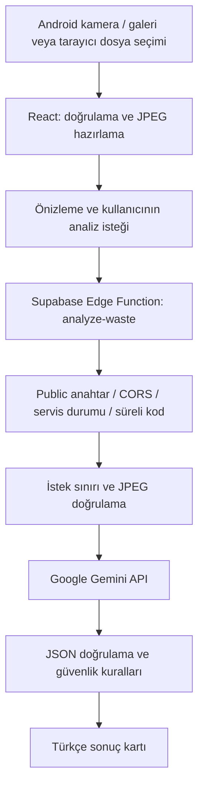

# Akıllı Atık

Akıllı Atık, Android telefonlarda atık fotoğraflarından Türkçe ayrıştırma önerileri sunmayı hedefleyen bir üniversite sosyal sorumluluk projesidir. React arayüzü Capacitor ile Android uygulamasına paketlenir; görüntü analizi Supabase Edge Function üzerinden Google Gemini API'ye bağlanacak şekilde geliştirilmiştir.

**Güncel durum — 10 Ekim 2026:** Fotoğraf ve analiz altyapısı hazırdır. `analyze-waste` Edge Function **ACTIVE, sürüm 1** durumundadır; **`ANALYSIS_ENABLED=false`** nedeniyle analizler kapalıdır. Gerçek Gemini analizi ve Android cihaz testi henüz yapılmamıştır. **Phase 3.1 PASS değildir; Phase 4'e geçilmemiştir.**

## Proje Tanıtımı

### Amaç ve Problem

Günlük yaşamda atığın malzemesini ve doğru teslim yöntemini belirlemek her zaman kolay değildir. Yanlış ayrıştırma geri dönüştürülebilir malzemeleri kirletebilir; pil ve elektronik gibi özel toplama gerektiren atıkların evsel çöpe karışmasına neden olabilir.

Projenin amacı, bir fotoğraf üzerinden anlaşılır yönlendirme sağlayarak doğru ayrıştırma alışkanlığını desteklemektir. Görsel değerlendirme kesin teşhis olarak sunulmaz; belirsizlikler ve yerel kuralların doğrulanması gereği açıklanır.

### Sosyal Sorumluluk Katkısı ve Hedef Kullanıcılar

Öğrenciler, haneler ve geri dönüşüm konusunda bilgiye ihtiyaç duyan Android kullanıcıları hedeflenir. Çevre farkındalığını artırmak, özel atıkların güvenli teslimini teşvik etmek ve geri dönüşüm eğitimini erişilebilir kılmak amaçlanır. Henüz ölçülmüş çevresel etki veya tasarruf sonucu bulunmamaktadır.

## Temel Özellikler

### Geliştirilmiş Özellikler

- Türkçe arayüz, mobil navigasyon, uyarlanabilir düzen ve güvenli ekran alanı stilleri.
- Capacitor Camera ile Android kamerasından fotoğraf alma ve galeriden tek görsel seçme.
- Tarayıcıda dosya seçimi; destekleyen mobil tarayıcılarda kamera seçeneği.
- Fotoğraf önizleme, değiştirme ve kaldırma; izin reddi ve iptal yönetimi.
- JPG/PNG/WebP içerik kontrolü, boyut sınırı ve oranı koruyan JPEG hazırlama.
- Analiz/yeniden deneme, yükleniyor göstergesi, sonuç kartı ve Türkçe hata yönetimi.
- Sunucuda Gemini görüntü isteği, JSON doğrulaması ve tehlikeli atık güvenlik kuralları.
- Public proje anahtarı, CORS, süreli test erişimi ve bellek içi istek sınırları.
- Android debug APK üretimi ve APK imza doğrulaması.

Kamera/galeri kodu uygulanmıştır; gerçek cihaz doğrulaması beklenmektedir. Analiz akışı otomatik testlerle sınanmıştır; gerçek Gemini yanıtı henüz alınmamıştır.

### Henüz Tamamlanmamış Özellikler

Kullanıcı girişi, analiz geçmişinin veritabanına kaydı ve gerçek verilerden istatistik üretimi uygulanmamıştır. Bu sayfalar hazırlık ekranlarıdır; sahte analiz, kayıt veya istatistik üretilmez. Harita ve puan sistemi mevcut değildir.

## Kullanılan Teknolojiler

| Katman | Teknoloji | Kullanım |
| --- | --- | --- |
| Arayüz | React 19, TypeScript 5.9 | Bileşenler, tip kontrolü ve durum yönetimi |
| Geliştirme ve derleme | Vite 8 | Yerel geliştirme ve üretim paketi |
| Stil | Tailwind CSS 4, özel CSS | Uyarlanabilir düzen ve erişilebilirlik stilleri |
| Navigasyon | React Router 7 | Sayfalar ve ortak düzen |
| Mobil köprü | Capacitor 8, Camera ve App | Android paketleme, fotoğraf ve geri yükleme |
| Android | JDK 21, SDK 36, Gradle 8.14.3, AGP 8.13.0 | Native proje ve debug APK |
| Servis platformu | Supabase, JavaScript istemcisi | Public yapılandırma; Auth/veritabanı işlemleri henüz yok |
| Sunucu | Supabase Edge Functions, Deno | HTTP uç noktası ve secret yönetimi |
| Yapay zekâ | Google Gemini API, gemini-3.5-flash-lite | Görüntü ve JSON şemalı analiz; canlı kabul bekliyor |
| Kalite | TypeScript, ESLint, Node.js test araçları | Frontend/Edge kontrolleri ve 34 otomatik test |

Tekrarlanabilir kurulum için `package-lock.json`, Android araç sürümleri için Gradle wrapper esas alınır.

## Sistem Mimarisi



Şema analiz etkinleştirildiğinde kullanılacak akışı gösterir. Mevcut canlı serviste geçerli public anahtarlı POST isteği **503 / `SERVICE_DISABLED`** ile sonlanır; Gemini'ye aktarılmaz.

Fotoğraf seçimi tek başına analiz başlatmaz. Analiz düğmesi küçültülmüş JPEG'i Edge Function'a iletir. Frontend Gemini anahtarını bilmez. Sunucu modeli çağırır, sonucu doğrular ve kabul edilen sözleşmeyi döndürür. İstemci yanıtı tekrar doğrular; fotoğraf değiştiğinde eski sonuç gösterilmez.

## Proje Yapısı

```text
Akilli-Atik/
├── src/
│   ├── components/           # Ortak düzen, boş durum ve analiz sonucu
│   ├── data/                 # Atık kategorileri
│   ├── hooks/                # Fotoğraf ve analiz durum yönetimi
│   ├── pages/                # Ana sayfa, tarama ve hazırlık ekranları
│   ├── services/             # Fotoğraf, analiz ve public yapılandırma
│   ├── App.tsx               # Uygulama rotaları
│   ├── main.tsx              # React başlangıcı
│   └── styles.css            # Mobil/masaüstü stilleri
├── supabase/
│   ├── config.toml           # Function giriş noktası ve JWT ayarı
│   └── functions/
│       ├── _shared/          # Ortak JSON, hata ve JPEG kuralları
│       ├── analyze-waste/    # HTTP handler, Gemini ve süreli erişim
│       ├── runtime.d.ts      # Tip kontrolü için Deno tanımları
│       └── .env.example      # Sunucu ayar şablonu
├── tests/                    # Analiz, fotoğraf, yapılandırma ve erişim testleri
├── android/                  # Native Android kaynakları ve Gradle wrapper
├── docs/                     # Doğrulama raporu ve tarihsel kayıtlar
├── .env.example              # Public frontend ayar şablonu
├── capacitor.config.ts       # Uygulama kimliği, adı ve web çıktısı
├── package.json              # Komutlar ve bağımlılıklar
└── tsconfig*.json            # Frontend, araç ve Edge tip kontrolleri
```

`node_modules`, `dist`, yerel `.env` dosyaları, SDK yolu, cache, üretilmiş Android web varlıkları ve APK Git'e dahil edilmez. `android:sync` gerekli varlıkları yeniden üretir.

## Kurulum ve Çalıştırma

### Gereksinimler

- Git, Node.js **24 LTS** ve npm. Kontroller Node.js 24.18.0 / npm 11.16.0 ile yapılmıştır; testler Node'un TypeScript tiplerini kaldırma desteğini kullanır.
- Android için JDK 21, Android Studio, SDK Platform 36, Build-Tools 36.0.0 ve Platform-Tools. SDK lisansları kabul edilmiş olmalıdır.
- Canlı sunucu yönetimi için Supabase hesabı ve CLI; doğrulanan CLI sürümü 2.120.0.

### npm Kurulumu ve Yerel Geliştirme

Repository'yi klonladıktan sonra proje dizininde:

```powershell
npm ci
npm run dev
```

Terminalde verilen adresi açın; varsayılan `http://localhost:5173` olur. Fotoğraf seçimi ve arayüz için Gemini anahtarı gerekmez.

```powershell
npm run build
npm run preview
```

`preview` üretim sunucusu değildir. Web yayını yapılırsa React Router rotaları için `index.html` yönlendirmesi gerekir.

### Frontend Ortam Değişkenleri

`.env.example` dosyasını `.env.local` olarak kopyalayın; mevcut yerel dosyanız varsa üzerine yazmayın. Yalnız URL ve **public publishable/anon** anahtarını ekleyin:

```dotenv
VITE_SUPABASE_URL=https://PROJECT_REF.supabase.co
VITE_SUPABASE_PUBLISHABLE_KEY=
```

`VITE_` değerleri frontend paketine dahil edilir. Gemini, service_role veya `sb_secret_` anahtarları buraya eklenmez. Ayar değişince geliştirme sunucusunu yeniden başlatın; APK'yı yeniden derleyin.

### Android Senkronizasyonu ve APK

`JAVA_HOME` JDK 21 dizinini, `ANDROID_HOME` SDK dizinini göstermelidir. SDK yolu Android Studio veya Git dışında kalan `android/local.properties` üzerinden de ayarlanır. Ortam değişkenlerini güncelledikten sonra terminali yeniden açın.

```powershell
npm run android:sync
npm run android:open
npm run android:apk
```

`android:sync` üretim paketini oluşturup Android'e kopyalar; `android:open` Android Studio'yu açar. `android:apk` build, sync ve `assembleDebug` adımlarını içerir. Çıktı:

```text
android/app/build/outputs/apk/debug/app-debug.apk
```

Uygulama adı **Akıllı Atık**, kimliği **`com.akilliatik.app`**, minimum API **24**, hedef/derleme API **36**'dır. USB hata ayıklaması etkin ve bilgisayara yetki verilmiş telefona kurulum:

```powershell
adb devices
adb install -r android/app/build/outputs/apk/debug/app-debug.apk
```

Debug APK geliştirme içindir; mağaza yayını ve release imzalama bu kapsamda yapılmamıştır.

### Supabase Yapılandırması

Bağımsız proje **Akilli-Atik**, Project Ref **`nyoxbwandadakfagoner`**, URL **`https://nyoxbwandadakfagoner.supabase.co`**'dur. Bunlar public tanımlayıcılardır; gerçek anahtar değerleri repository'de bulunmaz. Yetkili bakımda önce doğru hesap ve proje doğrulanır:

```powershell
npx supabase@2.120.0 login
npx supabase@2.120.0 projects list
npx supabase@2.120.0 link --project-ref nyoxbwandadakfagoner
```

Doğrulama kodlarını yalnız standart giriş ekranlarında kullanın; Git'e, rapora veya sohbete eklemeyin. Başka Supabase projeleri bu uygulama için kullanılmaz. Dashboard → Edge Functions → Secrets ayarları:

| Ayar | Amaç ve güncel durum |
| --- | --- |
| `GEMINI_API_KEY` | Yalnız sunucuda mevcut; geçerliliği canlı çağrıyla doğrulanmadı |
| `GEMINI_MODEL` | `gemini-3.5-flash-lite` |
| `ANALYSIS_ENABLED` | **false**; ayrı onay olmadan değiştirilmez |
| `ANALYSIS_PUBLIC_KEY` | Frontend ile eşleşen public anahtar; değeri belgelenmez |
| `ALLOWED_ORIGINS` | `https://localhost,http://localhost,capacitor://localhost` |
| `ANALYSIS_TEST_TOKEN` | Gerçek test kodu henüz oluşturulmadı |
| `ANALYSIS_TEST_EXPIRES_AT` | Kontrollü testten hemen önce kodla birlikte ayarlanacak |

Bu ara görev yeni deployment veya analiz etkinleştirme içermez. Kapalı deployment sonuçları [doğrulama raporunda](docs/dogrulama-raporu.md) bulunur.

## Yapay Zekâ Analiz Sistemi

### Fotoğraf Yükleme ve Görüntü Doğrulama

İstemci en fazla **20 MiB** JPG/PNG/WebP girdisini kabul eder; dosya uzantısına ek olarak içerik imzasını kontrol eder. **64 milyon piksel** üzeri görseller reddedilir. En-boy oranı korunarak en uzun kenar **1600 piksel** yapılır; JPEG çıktı **5 MiB** sınırına tabidir.

Sunucu `image/jpeg` türünü, akış boyutunu ve JPEG yapı/ölçülerini tekrar kontrol eder. `Content-Length` bulunmasa da boyut sınırı uygulanır. Bu kontrol tam görüntü çözücüsü değildir; çözülebilirlik Gemini tarafında da değerlendirilir.

### Gemini Analizi ve JSON Yanıtı

Gemini REST `generateContent` isteği görüntü ve Türkçe sistem talimatı içerir; JSON şemalı çıktı ister. Yalnız tamamlanmış yanıt alınır. Şema dışı alanlar, geçersiz kategori, eksik alan, yanlış tür ve tutarsız başarı bilgisi reddedilir.

| Alan | Açıklama |
| --- | --- |
| `success` | Atık analizi başarılı mı? |
| `wasteName`, `category` | Ad ve kategori; atık yoksa null |
| `description` | Kısa Türkçe açıklama |
| `sortingInstruction` | Ayrıştırma talimatı |
| `recyclingAdvice` | Geri dönüşüm/teslim önerisi |
| `safetyWarning` | Güvenlik uyarısı veya null |
| `objectCount` | none, single veya multiple |
| `uncertain`, `hazardous` | Belirsizlik ve özel güvenlik işaretleri |

Kategoriler: **Plastik, Cam, Kâğıt/Karton, Metal, Organik, Elektronik, Pil, Diğer**. Birden fazla atıkta baskın nesnenin değerlendirildiği belirtilir; güvenli seçim yapılamıyorsa başarısız sonuç döner. Atık bulunamaması başarılı sınıflandırma sayılmaz. Güven yüzdesi üretilmez veya gösterilmez.

### Güvenlik Kontrolleri ve Hatalar

Pil, elektronik, tehlikeli işareti veya riskli nesne adı için ayrıştırma metni koruyucu kurallarla değiştirilir. Sökme, delme, yakma, hasarlı cihazı şarj etme ve evsel çöpe atma yönlendirmelerinin riski azaltılır. Modelin tehlikeli nesneyi kaçırmayacağı garanti edilmez; yerel kurallar yetkili kuruluşla doğrulanmalıdır.

İnternet yokluğu, ayar eksikliği, kapalı servis, erişim reddi, kota aşımı, geçersiz fotoğraf/JSON, servis hatası ve zaman aşımı Türkçe mesajlarla ele alınır. Fotoğraf değişimi veya ekranın kapanması aktif istemci isteğini iptal eder.

## Güvenlik

- Gemini anahtarı yalnız Supabase Edge secret'ıdır; frontend veya Git'e eklenmez.
- Yerel ortam dosyaları, CLI oturumu/doğrulama dosyaları, keystore, APK, cache ve rapor çıktıları Git dışında tutulur. Boş `.env.example` şablonları paylaşılır.
- `verify_jwt=false` kullanıcı Authentication'ı olmadığını yansıtır. Handler public anahtarı ayrıca kontrol eder; public anahtar kullanıcı kimliği veya gizli erişim kanıtı değildir.
- Analiz açıldığında 32–256 karakterlik test kodu ve en fazla 15 dakika ileride geçerli bitiş zamanı zorunludur. Eksik, geçersiz veya süresi dolmuş ayar erişimi kapatır.
- Test kodu yalnız ekran belleğinde tutulur; `VITE_`, kalıcı depolama veya log'a eklenmez. Native HMAC doğrulaması kullanılır.
- CORS tam origin listesi kullanır; joker izin yoktur. CORS kimlik doğrulama değildir; originsiz istek de erişim kontrolünden geçer.
- Isolate başına 3 istek/IP/dakika, 30 istek/saat ve 2 eşzamanlı çağrı sınırı vardır. IP header'ı yardımcı sinyaldir; bellek içi sınırlar dağıtık kalıcı kota sağlamaz.
- Gövde okuma 10 saniye, Gemini çağrısı 35 saniye, istemci 50 saniye zaman aşımına tabidir. Provider yanıtı en fazla 64.000 bayt okunur.
- Uygulama kodu fotoğrafı, secret'ları veya provider hata ayrıntılarını loglamaz; fotoğraf/analiz geçmişini veritabanına kaydetmez. Etkin analizde görüntü Supabase ve Google üzerinden işlenir; sağlayıcı veri politikaları ayrıca geçerlidir.

Koruma kontrollü pilot içindir. Genel kullanım öncesi dağıtık kota, kullanıcı yetkilendirmesi, maliyet sınırları ve operasyonel izleme ayrıca değerlendirilmelidir.

## Testler

```powershell
npm run typecheck
npm run lint
npm test
npm run android:apk
```

Otomatik testler gerçek Supabase/Gemini çağrısı yapmaz. Sentetik yanıtlar yalnız test dosyalarında bulunur; uygulama sahte sonuç üretmez. Kapsam: JSON, kategori/alan doğrulaması, atık bulunamaması, çoklu nesne, tehlikeli atık kuralları, HTTP/kota/zaman aşımı hataları, fotoğraf, public yapılandırma, CORS ve süreli erişim.

| Kontrol | Son doğrulanan sonuç — 10 Ekim 2026 |
| --- | --- |
| TypeScript: React, araçlar ve Edge | Başarılı |
| ESLint | Başarılı |
| Otomatik testler | **34/34 başarılı** |
| Production build | Başarılı |
| Capacitor sync | Başarılı |
| Android Gradle assembleDebug | Başarılı |
| APK imzası | v2 doğrulandı |
| Canlı Supabase kapalı HTTP kontrolleri | 7/7 beklenen yanıt; 204, 503, 403 ve 405 |
| Gerçek Gemini analizi | **Yapılmadı** |
| Android cihaz/emülatör işlev testi | **Yapılmadı** |

[Ayrıntılı rapor](docs/dogrulama-raporu.md), kontrollerin tarih ve kapsamını açıklar. Node handler testleri Deno yerel runtime veya fiziksel cihaz testi yerine geçmez.

## Geliştirme Aşamaları

| Aşama | Kapsam | Durum |
| --- | --- | --- |
| Phase 1 | React/TypeScript/Vite, sayfalar ve navigasyon | Tamamlandı |
| Phase 1.1 | Capacitor ve Android proje altyapısı | Tamamlandı; eksik araçlar Phase 1.2'de giderildi |
| Phase 1.2 | JDK/SDK/Android Studio, debug APK ve imza | Tamamlandı; cihaz testi hariç |
| Phase 2 | Kamera/galeri, önizleme ve fotoğraf hazırlama | Kod/otomatik kontroller tamamlandı; cihaz testi bekliyor |
| Phase 3 | Gemini/Edge kodu, JSON, güvenlik ve analiz ekranı | Kod/otomatik kontroller tamamlandı; gerçek API kabulü bekliyor |
| Phase 3.1 | Supabase bağlantısı ve kapalı deployment | **Kısmen tamamlandı; PASS değil** |
| Phase 4 | Sonraki geliştirme kapsamı | Başlatılmadı |

Önceki raporlar [geliştirme geçmişinde](docs/gelistirme-gecmisi.md) korunur. Güncel durumu bu README ve son doğrulama raporu belirtir.

## Mevcut Durum ve Sınırlamalar

- Function **ACTIVE, sürüm 1**; analiz **kapalı**.
- Gemini secret adı mevcut; model erişimi, kota ve gerçek yanıt kalitesi henüz sınanmadı.
- Gerçek test kodu ve uçtan uca fotoğraf analizi yok.
- Android kamera/galeri, izin reddi ve activity geri yükleme cihazda doğrulanmadı.
- Geçmiş, istatistikler ve giriş hazırlık ekranlarıdır; veritabanı kayıt işlemi yoktur.
- Bazı arayüz etiketlerinde eski aşama/metinler korunmuştur; canlı servisin açık olduğunu kanıtlamaz.
- Release APK/AAB, mağaza yayını, iOS ve genel kullanıcıya açık analiz yoktur.
- Phase 4'e geçilmedi.

## Sonraki Geliştirme Adımları

1. Kontrollü analiz etkinleştirmesi için ayrı açık onay.
2. Gerçek atık fotoğrafı dosya yolu ve Google'a gönderim izni.
3. Süreli test kodu/süre ayarı; gerçek Gemini yanıtı, Türkçe içerik ve JSON doğrulaması.
4. Yetkisiz/süresi dolmuş erişim ve hata kontrolleri; test sonunda analizin kapatılması.
5. Başarılı canlı analiz sonrası güncel APK ve fiziksel Android işlev testleri.
6. Phase 3.1 kabul değerlendirmesi; sonraki aşama için ayrıca onay.

## Dokümantasyon ve Resmî Kaynaklar

- [Doğrulama raporu](docs/dogrulama-raporu.md)
- [Tarihsel geliştirme raporları](docs/gelistirme-gecmisi.md)
- [Capacitor Android](https://capacitorjs.com/docs/android) · [Camera](https://capacitorjs.com/docs/apis/camera)
- [Supabase Edge Functions](https://supabase.com/docs/guides/functions) · [Secret yönetimi](https://supabase.com/docs/guides/functions/secrets)
- [Gemini modeli](https://ai.google.dev/gemini-api/docs/models/gemini-3.5-flash-lite) · [JSON şemalı çıktı](https://ai.google.dev/gemini-api/docs/structured-output)
